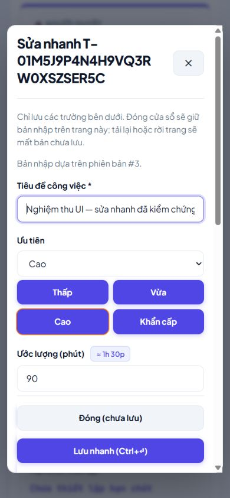
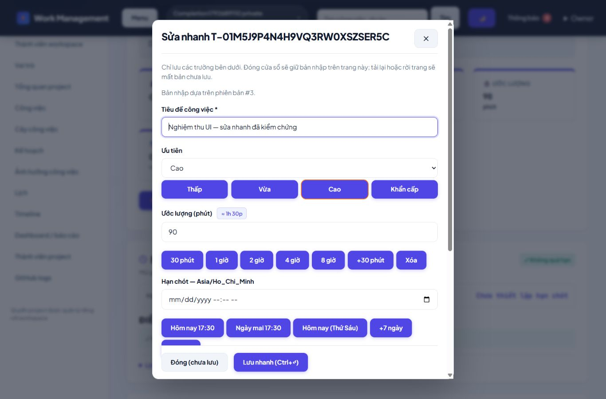

# Báo cáo hoàn thiện và nghiệm thu dự án — 23/10/2026

## 1. Kết luận và mức sẵn sàng

**Bản Laravel MVC/Blade hiện tại đã có đầy đủ các nhóm chức năng nội bộ trong phạm vi triển khai, được rà soát và chạy lại bằng flow thật trên bản cài riêng. Các lỗi tìm thấy trong đợt này đã được sửa và kiểm lại. Có thể dùng bản local để chuẩn bị demo/đồ án.**

Đây không phải chứng nhận “100% không còn lỗi”, chứng nhận bảo mật hay xác nhận production đã vận hành. AI/provider, SMTP, Redis production và webhook GitHub công khai còn cần cấu hình và kiểm chứng thực tế; phần đóng góp nhóm/bảo vệ cần người thật thực hiện. Không tự gán điểm số giảng viên.

Phạm vi kỹ thuật được đánh giá: source hiện hành tại `D:\HeThong_PhanTichTaiChinh\DO_AN_QUAN_LY_CONG_VIEC_PHP`, gồm FE do AI khác bàn giao và phần quick edit/conflict từ lượt trước. Không reset source hoặc ghi đè phần FE đó. Không thêm lớp test; dùng form/HTTP/session/CSRF thật, SQLite thật, private file và worker Artisan thật.

## 2. Số liệu và bằng chứng của lần kiểm tra này

Hạng mục | Kết quả
---|---
Điểm xác minh nghiệp vụ/flow có assertion đọc lại | **144 đạt**, trong các file flow hoàn tất; không tính lần kiểm tra dở hoặc số HTTP là số test
Request HTTP được ghi trong các flow hoàn tất | 389; webhook ký riêng ghi kết quả theo ca
Trang/module và assets | 40 URL trang đại diện trả200, CSS/JS tham chiếu tải được
Cú pháp PHP | 212 file hợp lệ
Blade biên dịch + PHP lint | 144 file hợp lệ
JS | 3 file qua `node --check`
Routes | 145 route đăng ký; route/config/view cache xây được
Composer | validate/platform requirements đạt; audit lock không có advisory/abandoned tại thời điểm chạy
Môi trường cài riêng | Migration mới + seed demo lặp2 lần:5 users / 40 tasks, không nhân đôi fixture, giữ key lần 2
Browser | 390 px và1366 px không tràn ngang trang task/modal; preset90 phút/Ctrl+Enter/SQL đúng; Escape trả focus; không lỗi console trong phiên kiểm
Log Laravel review | 0 dòng ERROR ở lần chốt kỹ thuật
Database chính | Cả31 bảng giữ nguyên count/hash, `.env`/APP_KEY giữ nguyên; FK check sạch
Database review cuối | 8 users, 13 workspaces, 8 projects, 71 tasks, 7 plans, 23 calendar_events, 87 task_activities, 3 notifications, 1 time_entries, 2 task_reminders

Nguồn số liệu: [summary.json](verification/completion-2026-10-23/summary.json), [technical.json](verification/completion-2026-10-23/technical.json), [browser.json](verification/completion-2026-10-23/browser.json). Request cố ý trả403/404/409/419/422 là nhánh bảo vệ dự kiến, không tính là lỗi500.

Các lần kiểm tra dở được giữ để minh bạch: lần 1 bộ kiểm tra kỳ vọng đăng nhập về `/workspaces` trong khi Laravel đúng là về trang intended `/profile`; lần 2 đọc nhầm `data.slots` thay vì `data.payload.slots`. Đã sửa công cụ đọc bằng chứng, chạy lại trọn flow và đạt. Lần gọi webhook đầu bị dev server khởi động lại khi `.env` review thay đổi; đã chờ server sẵn sàng và chạy lại. Không sửa ứng dụng để né các tình huống của công cụ kiểm tra này.

## 3. Các sửa đổi cụ thể trong đợt nghiệm thu

Mục | Trước | Sau và cách kiểm
---|---|---
Tìm kiếm ký tự đặc biệt | Project/workspace/task/nguồn Plan dùng LIKE trực tiếp, `%`/`_` có thể mở rộng kết quả khác tìm kiếm tổng | `SearchTerm::contains()` escape `!/%/_`, dùng bound parameter và ESCAPE thống nhất. Flow list/Kanban/project/workspace kiểm không trả dòng không khớp
Nội dung lịch sử | `low` hoặc `DONE` trong title/description có thể bị dịch thành nhãn enum | Chỉ dịch status/priority/task_type; lịch sử hiển thị đúng chữ do người dùng nhập và vẫn escape HTML. SQL/history/HTML đã đọc lại
Header mobile | Header sticky nhiều dòng cao khoảng359px ở màn hình hẹp, che nội dung; z-index cao hơn drawer | Header mobile cuộn theo trang, drawer nằm trên; bố cục nhỏ và ellipsis tên workspace. Click điều hướng và menu/Escape đã kiểm trên browser
Tiêu đề thẻ dài | Link inline xuống dòng có khoảng trống trong vùng nhìn như có thể bấm | Link tiêu đề trong card là block; click tên project nhiều dòng điều hướng thành công
Nhãn UI | `on_hold` hiện mã nội bộ; textarea sửa comment thiếu label | Hiện “Tạm hoãn”, vẫn gửi enum gốc; thêm label cho textarea sửa comment
Hồ sơ thiết kế | ERD V3 chỉ mô tả20 bảng gốc | Thêm schema/ERD hiện hành23 bảng nghiệp vụ và sơ đồ tác nhân/chức năng/MVC, giữ nguyên tài liệu V3

Không thêm migration, không đổi Laravel MVC sang API/SPA, không thêm package hoặc TestCase. Phần modal/preset/conflict đã xây ở lượt trước được kiểm hồi quy trong lượt này, không nhận đó là tính năng mới của lượt này.

## 4. Đối chiếu 26 tiêu chí từ ảnh yêu cầu

Mã | Tiêu chí | Đánh giá và minh chứng
---|---|---
01 PLO1 | Đối tượng, vai trò, dữ liệu, quy trình, phạm vi/ràng buộc | Có: kế hoạch V3 + CURRENT_SYSTEM + scope/limits trong báo cáo này
02 PLO2 | CSDL hợp lý, ERD, quan hệ | Có: ERD V3 và ERD_CURRENT/schema-current; FK check sạch
03 PLO2 | Migration, model, relationship Laravel | Có; cài DB rỗng và seed lặp đạt;23 bảng nghiệp vụ,8 hạ tầng
04 PLO2 | Vai trò và phân quyền | Có; Policy/Access/membership, Viewer403, scope riêng, thu hồi quyền trước worker
05 PLO2 | Route/controller/view rõ ràng | Có; route modules, Controllers/Requests/Services/Models/Blade, cache routes/views đạt
06 PLO2 | Use case/ERD/sơ đồ chức năng | Có: CURRENT_SYSTEM + ERD_CURRENT + USE_CASES.puml; UML use-case bàn giao dạng nguồn, Mermaid là bản xem nhanh
07 PLO3 | CRUD chính | Có; project/task/calendar/member/role; task có lịch sử dùng archive/restore, không xóa lịch sử tùy tiện
08 PLO3 | Tìm kiếm/lọc/sort/page | Có; scoped global search, list/Kanban, saved filters/bulk; wildcard literal đã sửa
09 PLO3 | Laravel MVC/Blade | Đáp ứng; form web session/CSRF, không cần REST API cho FE
10 PLO3 | Validation form | Có; empty/enum/code/relationship/revision/deadline reason; giữ dữ liệu nhập
11 PLO3 | Đăng nhập/đăng xuất/xác thực | Có; đăng ký/profile/password/session revoke/login/logout thực tế
12 PLO3 | Blade rõ/dễ dùng/layout | Có; responsive, menu, preset/quick edit/conflict; đã sửa lỗi header/card click. Chưa khảo sát usability với người dùng độc lập
13 PLO3 | Hoạt động ổn định | Các flow được liệt kê đều đạt, review log không ERROR; chưa có load/soak test production
14 PLO3 | Đầu vào và thông báo lỗi rõ | Có; FormRequest, error summary, lỗi nghiệp vụ hiển thị qua Blade
15 PLO3 | Trống/sai định dạng/trùng mã/notfound | Có; minh chứng quick flow/boundaries và các stage trước; notfound404, malformed/revision guard
16 PLO3 | CSRF/auth/phân quyền | Có; CSRF419, Viewer403, scope/token404; HMAC riêng cho webhook
17 PLO3 | Minh chứng kiểm thử chức năng | Có; flow JSON + SQL/worker/browser + ảnh, không dùng TestCase/mocks
18 PLO3 | Chạy môi trường Laravel chuẩn | Đã cài tách biệt cùng máy; PHP/Composer/cache đạt. Cần chạy thêm máy giảng viên/production đích
19 PLO3 | DB/migration/seed | Có; .env.example + migrations + DemoSeeder gắn nhãn
20 PLO3 | Hướng dẫn cài/chạy | README/DEPLOYMENT + setup-local/serve-local/workers; bản source ZIP có manifest
21 PLO3 | Source rõ/đủ file | Có; kiểm source package không có .env/liveDB/private/vendor, composer.lock được giữ
22 PLO6 | Phân công thành viên rõ | **Cần nhóm hoàn tất** tên thật/vai trò, khung TEAM_WORKLOG đã có
23 PLO6 | Đóng góp phù hợp | **Cần minh chứng con người**; không phân bổ công lao AI thành đóng góp cá nhân giả
24 PLO6 | Nhật ký/commit/minh chứng tiến độ | Có log kỹ thuật và lịch sử Git; **cần nhóm ghi đóng góp và commit thực tế từng người**
25 PLO6 | Phối hợp/giải quyết vấn đề/đúng hạn | **Cần nhóm xác nhận** qua tiến độ/họp/phân công thật
26 PLO1/2/3 | Demo và trả lời bảo vệ | Đã chuẩn bị flow/code/docs; **cần thành viên tự demo, giải thích và trả lời**

Về hồ sơ kỹ thuật01–21, đã có triển khai và bằng chứng theo phạm vi local với các giới hạn nêu rõ. Điều này không tương đương được chấm đủ điểm26 tiêu chí;5 tiêu chí cuối cần hoạt động thật của nhóm, và yêu cầu hình thức sơ đồ/môi trường nộp phụ thuộc giảng viên.

## 5. Flow qua các hàm chính

- **Auth/Workspace**: `RegisteredUserController::store → RegistrationService::register → WorkspaceService::create` tạo user/workspace cá nhân/role/membership trong transaction. `LoginRequest::authenticate → SessionController::store` tạo phiên; `ProfileController::password` đổi hash và xóa phiên khác; logout invalidate session.
- **Quyền/Member**: middleware active.user/workspace.member → `WorkspaceAccess/ProjectAccess` → Policy; `InvitationService` tạo/nhận lời mời theo email; `MemberService` và `ProjectMemberService` kiểm lại quyền và trạng thái. Workspace role không tự thay project role.
- **Project/Task**: FormRequest → `ProjectController/TaskController` → `ProjectService::save/TaskService::save` → lock/permission/revision → Eloquent → history/tree sync → redirect Blade. `SearchTerm::contains` chỉ tạo pattern cho truy vấn bound, không can thiệp quyền.
- **Sửa nhanh/xung đột**: JS chỉ mở dialog/điền preset/gửi native form → `TaskController::update → saveEdit → TaskService::save`. Khi revision cũ: `TaskEditConflict::prepare` tạo snapshot/token session →409. Chọn từng trường → `resolveEdit → TaskEditConflict::resolve → fieldRules → saveEdit`; có cập nhật thứ ba thì đối chiếu lại, không ghi đè ngầm.
- **Cây/Review/FS**: `TaskTreeService::validate/sync/progress`; `TaskWorkflowService::status → blockingReason` kiểm graph, assignee/reviewer, blocker, FS/lag, timer và reason; `dependency` cùng IntegrityObserver chặn chu trình. Lịch sử nằm cùng transaction.
- **File/Comment**: AttachmentFormat kiểm loại/nội dung → `TaskAttachmentService::store` ghi private file và activity; download kiểm Policy+path; remove soft-delete. Comment chỉ người tạo sửa, người đủ quyền có thể gỡ theo service.
- **Calendar/Timeline**: `CalendarEventRequest → CalendarService::localTime/save` chuyển UTC, kiểm version/timezone/busy conflict; `CalendarViewService` chiếu dữ liệu theo quyền, ẩn private title/id. Timeline dùng TASK_BLOCK thật.
- **Timer/Report**: `TimeTrackingService::start/stop`; `TimeAdjustmentService` lưu bản điều chỉnh có audit; `ReportService::metrics/snapshot` tách estimate/planned/actual, snapshot cố định; ReportController xuất CSV/print.
- **Plan**: `PlanController::store → PlanService::create/validate/fingerprint`; `PlanReviewService::preview` mô phỏng transaction rồi rollback; `transition` duyệt/apply kiểm quyền/current source, ghi TaskService/CalendarService nguyên tử. `PlanScheduleService::suggest` tạo version local, chưa apply.
- **Queue/Integration**: AiRunService → ProcessAiRun → provider bridge; chưa cấu hình báo failed. TaskReminderService → SendTaskReminder kiểm lại quyền/dedupe → NotificationService. GithubWebhookService kiểm HMAC/repository/delivery, tạo log/activity, không tự đổi trạng thái task.

## 6. Các luồng đã chạy thật

Nhóm | Bằng chứng mới | Kết quả nổi bật
---|---|---
Lõi task | flow-core.json | Tạo12 task, Kanban10 + 2 không trùng, search theo scope, literal, savedfilter, bulk rollback, blocker/FS, timer thật, REVIEW/DONE, comment escape
Lịch/kế hoạch | flow-calendar-plan.json | Calendar stale lần 2 không ghi đè, lưu sau khi tải mới, busy conflict, draft→preview→propose→approve→apply, apply lặp không trùng
Báo cáo/queue | flow-reports-queue.json | Actual từ timer thật, điều chỉnh giờ có audit, snapshot cũ giữ byte, worker AI thất bại đúng cấu hình, nhắc việc thật và dedupe
Quản trị/file | flow-admin.json | RoleCRUD, mời qua mail log/nhận lời, projectmember revoke, worker recheck, ẩn nội dung lịch bận private, upload/download đúng bytes, settings
Biên/hồi quy | flow-boundaries.json | Ký tự đặc biệt, lịch sử giữ nguyên chuỗi, auth/profile/password, cycle/dependency/lag/review, archive/restore, local schedule, kế hoạch lỗi thời rollback
Quickedit | quick-flow-http.json | Revision/token/session/scope/replay/thirdedit, validation mở lại modal, UTC+14/−11preset và đọc lại UTC
GitHub | flow-github.json | Signed local 204, unsigned 403, repo 422, dedupe, secret được mã hóa, disable 403; không gọi GitHub public
Trang/asset | flow-pages.json | 40 URL/module + assets thực tế

Tất cả nằm trong [thư mục minh chứng](verification/completion-2026-10-23/README.md). Lời mời chỉ gửi mail log trong bản kiểm tra, không gửi email cho người thật. Data demo/review gắn tên riêng; không dùng DB chính để thử nghiệp vụ.

## 7. Những gì còn cần xem xét trước khi nộp hoặc vận hành

Mức | Việc còn lại | Vì sao / tiêu chí hoàn tất
---|---|---
Bắt buộc khi bật AI | Chọn/cấu hình HTTPS AI bridge,key,model; chạy planning/replanning/assistance/report thật | Hiện chỉ xác minh queue và disabled failure; cần kết quả nhà cung cấp qua contract, quyền, retry và duyệt trước apply
Bắt buộc production | HTTPS,APP_DEBUG=false,mail/Redis/queue/scheduler service,backup/private storage/giám sát | Helper local chưa phải dịch vụ production; cần chứng minh notification/mail/worker qua khởi động lại
Bắt buộc khi nối GitHub | Domain HTTPS,secret mạnh,repoID thật,webhookdelivery GitHub public | Signed localhost không chứng minh mạng công khai/cấu hình GitHub
Bắt buộc hồ sơ nhóm | Phân công/tên/log/commit thực,video/demo/bảo vệ | Không thể thay thế bằng báo cáo tự động
Trước nộp | Cài trên máy thứ hai và xác nhận DB mục tiêu/extensionZIP | Đã cài sạch cùng máy, dùng vendor có sẵn; chưa tải dependency từ mạng trên máy sạch
Trước nộp sơ đồ | Mở USE_CASES.puml và ERD_CURRENT.mmd bằng công cụ của nhóm, xuất ảnh cho báo cáo | Đã có nguồn UML/ERD; chưa xác nhận bản render PlantUML bằng công cụ ngoài
Khi quy mô lớn | Profiling N+1/tree/scopedsearch/report; workload1000–10000 task, concurrency và MySQL/Postgres nếu chọn | Hiện SQLite local, chưa có benchmark/productionSLA
Đợt cải tiến tùy chọn | Userstudy, contrast/screenreader/browserSafari/Firefox, chuẩn hóa hết câu chữ, module translations nếu chọnEnglish | Đã kiểm trình duyệt hiện tại và keyboard/responsive; chưa chứng nhận WCAG hay toàn bộ trình duyệt
Quản lý phát hành | Rà diff và commit/push bộ thay đổi local theo nhánh nhóm | Lượt này không push/deploy lên GitHub/production; mã và gói nguồn nằm trên máy

Các giới hạn có chủ đích: xóa vật lý task có history bị chặn; local scheduler chỉ xếp việc giao cho actor; planapply chỉ sửa việc chưa bắt đầu và không tự xóa task cũ khi bỏ dòng; report snapshot có kiểm quyền hiện tại; attachment gỡ vẫn giữ bytes private cho audit. Google Calendar/Telegram/email digest chưa nằm trong chức năng đã bật.

## 8. Cách chạy và nhận bàn giao

```powershell
cd D:\HeThong_PhanTichTaiChinh\DO_AN_QUAN_LY_CONG_VIEC_PHP
php scripts/serve-local.php
# Terminal khác nếu cần nhắc việc:
php artisan queue:work database --queue=work-management-reminders --sleep=1 --tries=3
# Terminal khác nếu cần xử lý AI queue:
php artisan queue:work database --queue=work-management-ai --sleep=1 --tries=3
```

Mở `http://127.0.0.1:8123`. Nếu PHP chưa có PATH, dùng `C:\xampp\php\php.exe`. Đây là hướng dẫn khởi động server chính; bản kiểm tra đang dùng8126 và database riêng. Xem DEPLOYMENT.md cho cài mới/scheduler/production; không chạy migrate:fresh trên dữ liệu đang dùng.

- [Bàn giao FE](FRONTEND_HANDOFF.md)
- [Thiết kế hiện hành](design/CURRENT_SYSTEM.md)
- [Hướng dẫn triển khai](DEPLOYMENT.md)
- [Kịch bản demo và tiêu chí](DEMO_AND_CRITERIA.md)
- [Minh chứng kiểm tra](verification/completion-2026-10-23/README.md)
- Gói source: `dist/work-management-mvc-source.zip`, kèm `source-manifest.json`. Không có env/key/DB thật/private/vendor; cần Composer dependencies khi cài máy khác.





## 9. Đọc kết quả có giới hạn

- 144 điểm đạt gồm điều kiện kiểm tra và đọc lại dữ liệu, kể cả tạo dữ liệu đầu vào; đây không phải 144 kịch bản người dùng độc lập hay số đo độ bao phủ mã nguồn.
- Nhánh trùng mã, file sai định dạng, account throttling và nhiều boundary đã có minh chứng các đợt trước; báo cáo này chỉ gọi là kiểm lại khi có flow mới tương ứng. Không suy diễn mọi nhánh đều đã chạy lại.
- Chưa diễn tập mất điện, crash worker giữa transaction, restore trên máy thứ hai hoặc đồng thời nhiều tiến trình production. Hai phiên chỉnh sửa lỗi thời đã được kiểm; điều đó chưa thay thế stress test cạnh tranh tải cao.
- Package-install từng dừng vì bộ kiểm tra nhận cả `storage/app/private/.gitignore` là dữ liệu private. Đã xác nhận chỉ có file giữ cấu trúc thư mục và sửa bộ kiểm tra, không có dữ liệu private hoặc DB thật trong ZIP.


## 10. Kiểm chứng gói bàn giao cuối

Đã giải nén source ZIP sang thư mục mới, kiểm hash toàn bộ manifest, cài migration/seed từ đầu, cache route/view và đăng nhập thật bằng server helper trên cổng8127. Các trang authenticated hồ sơ/settings/timer/search hoạt động. Server kiểm gói đã dừng sau khi hoàn tất. Dependency vendor được tái sử dụng từ cùng máy; không nhận là cài qua mạng hoặc máy vật lý thứ hai.

Sau lần cài, chỉ hoàn thiện tài liệu. Hash mọi file runtime/source trong gói cuối đã đối chiếu với bản vừa cài và giữ nguyên. Xem [kết quả cài gói](verification/completion-2026-10-23/final-package-install.json) và [đối chiếu source](verification/completion-2026-10-23/final-readiness.json).
