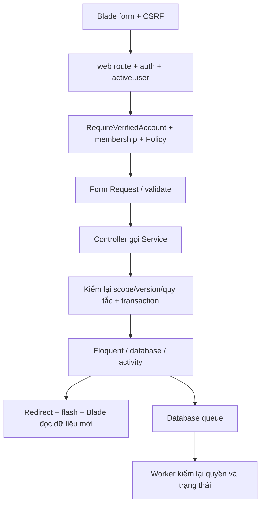

**Cập nhật F11–F14 ngày 23/10/2026:** đã triển khai và kiểm tra trên bản review35bảng; database chính31bảng đang chờ xác nhận migration riêng. Đọc [báo cáo mới](FULL_FUNCTIONAL_COMPLETION_2026-10-23.md) và [bàn giao FE](FRONTEND_F11_F14_HANDOFF.md). Các mô tả F11–F14 “backlog/chưa triển khai” bên dưới là lịch sử.

# Báo cáo rà soát toàn dự án và chuẩn bị production — 23/10/2026

## 1. Kết luận có căn cứ

**Phần nghiệp vụ cốt lõi có minh chứng hoạt động trên bản cài riêng; chưa chấp thuận đưa cấu hình local hiện tại lên production.** Đã sửa và bổ sung luồng tài khoản, bảo vệ HTTP, kiểm tra vận hành, sao lưu/khôi phục và tài liệu. Không thêm lớp test; kiểm tra bằng form/session/CSRF, HTTP, SQL, filesystem và worker thật.

Vòng này hoàn tất **179 điểm xác nhận, 339 HTTP request được ghi nhật ký** trong9 flow. Điểm xác nhận bao gồm cả exit code các lệnh vận hành, không phải 179 test case độc lập hay tỷ lệ bao phủ. Webhook, các request kiểm tra sự cố và thao tác browser còn có bằng chứng riêng; không cộng ước lượng. Không dùng kết quả PHPUnit mặc định để chứng minh nghiệp vụ.

Preflight production được chạy trên môi trường local và **trả mã lỗi đúng**: có demo, APP_ENV/debug/HTTP/cookie/mail/Redis/verification chưa phù hợp, Windows thiếu cơ chế timeout worker đã kiểm chứng. Không sửa `.env` chính để biến máy local thành production. Các bước ở [runbook](PRODUCTION_RUNBOOK.md) là điều kiện triển khai thực tế.

## 2. Căn cứ và phạm vi đọc

- Lịch sử yêu cầu hiện có trong cuộc trò chuyện này: MVC/Blade, các phần1–10, P0, P1, F04–F10, bàn giao FE, flow thật, giữ dữ liệu/key, chuẩn bị production.
- Chat cùng project “Tóm tắt dự án Laravel” đã được đọc hết các lượt được công cụ trả về (không còn trang cũ). Báo cáo Word/PDF và commit của chat đó được giữ nguyên.
- AGENTS.md, kế hoạch V3, CURRENT_SYSTEM/ERD/schema hiện hành, tiến độ, tài liệu từng phần, cải thiện UI/UX, bàn giao FE, deployment, báo cáo nghiệm thu và bằng chứng trước đây.
- Không khẳng định đã truy xuất được mọi chat lịch sử không còn nằm trong danh sách công cụ. `sources/` của mirror không có tài liệu khả dụng trong lượt này và được giữ nguyên.

Schema hiện hành: **23 bảng nghiệp vụ +8 bảng hạ tầng=31 bảng**. ERD20 bảng là lịch sử thiết kế; nguồn triển khai là migrations và [thiết kế hiện hành](design/CURRENT_SYSTEM.md). Vòng này không thêm migration hoặc thay schema.

## 3. Các khoảng trống đã xử lý

| Vấn đề | Thay đổi | Bằng chứng |
|---|---|---|
| Người quên mật khẩu không có đường phục hồi | Forgot/reset Blade, Password broker, token băm/hết hạn/dùng một lần, lock và transaction, thu hồi session/remember token | account-security, security-edges |
| Email chưa được xác minh vẫn vào nghiệp vụ | Signed link60 phút; yêu cầu xác minh mặc định ở production; giữ đường sửa email/logout; đổi email bắt xác minh lại | account-security |
| Thay mật khẩu/email còn để reset link cũ tồn tại | Xóa reset token khi đổi thông tin nhạy cảm trong profile | account-security |
| Hạn mức auth dùng chung giữa route gây429 nhầm khi đi nhiều bước | Đặt tên bộ đếm riêng cho login/register/recovery/reset/verification | Lần lỗi giữ ở attempt-account-shared-throttle; bản sửa chạy hết flow |
| Chỉ có `/up` nên khó biết cấu hình/worker/scheduler chưa đúng | `app:preflight --production --runtime`, cache probe/lock, DB/migrations, session wiring, heartbeat theo queue | operations + preflight-production.json |
| AI recover-stale có command nhưng chưa đăng ký lịch | Đăng ký mỗi phút, cleanup reset token mỗi giờ, heartbeat scheduler; mẫu Supervisor/timer | schedule:list + worker/scheduler thật |
| Thiếu kiểm soát Host, cache trang riêng và lỗi khi DB hỏng | Trusted hosts theo APP_URL, proxy allowlist, security headers, no-store/no-referrer,500/503 độc lập DB | Host400, DB outage500, maintenance503 |
| Chưa có công cụ/diễn tập khôi phục gắn DB và private files | Backup SQLite trong maintenance, manifest/hash/FK/attachment check; restore sang app/database riêng | operations + security-edges |
| Dễ dùng nhầm setup-local hoặc mang dữ liệu nhạy cảm vào gói nguồn | Guard local/testing; package loại thêm PEM/P12/PFX/dump/SQL/BAK và đưa deploy templates vào source | production refusal, final source audit |
| Sau update browser có thể giữ CSS/JS cũ | URL tài nguyên dùng mtime version trong layout chung | final-install/asset smoke |

Đã giữ các cải tiến UX trước đó: sidebar theo phạm vi, điều hướng project, bộ lọc dùng chung List/Kanban, journey của task, lý do bị chặn, anchor đến phần xử lý và hướng dẫn project. Không viết lại FE của AI khác từ đầu.

## 4. Ma trận chức năng theo mục đích sản phẩm

| Module | Flow và trạng thái kiểm chứng | Giới hạn còn giữ rõ |
|---|---|---|
| Auth/Profile | Register/login/logout, reset/verify, đổi email/mật khẩu, session invalidation | Mail log local; chưa chứng minh SMTP nhận thư thật |
| Workspace/Role/Member | Owner/custom role/mời/nhận lời mời, project member, thu hồi quyền | Production invitation cần Redis; chưa diễn tập Redis host thật |
| Project/Task | CRUD, câyGROUP/WORK/MILESTONE, scope, search, literal wildcard, sort/pagination, Kanban, quick-edit, stale conflict | Bộ flow đại diện; chưa kiểm tải dữ liệu lớn/concurrency trên DB đích |
| Trạng thái và quan hệ | IN_PROGRESS→REVIEW→DONE; reason khi trả lại; blocker, FS/lag/cycle, archive/restore, audit | Không tự bỏ qua review hoặc hoàn thành theo commit GitHub |
| Activity/File/Timer | Bình luận, file private, timer thật, chỉnh giờ có audit, thu hồi quyền | Không tuyên bố có dịch vụ antivirus/DLP hoặc remote object storage |
| Calendar/Timeline | UTC↔timezone, private busy, edit version, conflict, lịch theo project/user | Scheduler local chỉ xếp việc của người dùng hiện tại |
| Plan | Draft/version/preview/propose/approve/apply; stale source/rollback/idempotence | Không tự áp dụng đề xuất AI; công việc đã bắt đầu giữ guard hiện tại |
| Dashboard/Report | Snapshot bất biến, report mới theo dữ liệu chỉnh, CSV/print theo quyền | Chưa có benchmark tải production |
| Tiện íchF04–F10 | Preset/saved filters, bulk, reminders, deadline, operations, time correction | In-app đã kiểm; email digest/Telegram không được tuyên bố có |
| AI/GitHub | Queue thật, fail minh bạch khi AI tắt; HMAC/dedupe/repo-scope của webhook loopback | Chưa có key/provider thật hay delivery GitHub qua Internet |
| F11–F14 | Vẫn là đề xuất P2 trong tài liệu: team scheduling, giờ làm tùy chỉnh, watchers/multi-assignee, recurring/templates | Chưa triển khai. Không ghi nhận chúng là chức năng đã có. Cần chốt nghiệp vụ trước khi mở rộng |
| F15 | Tìm kiếm xuyên project trên tập được phép xem đã có | Không trả tiêu đề/count ngoài quyền |

“Hoàn thiện” ở đây là phạm vi cốt lõi đã triển khai và được duyệt qua các phần trước. Nếu F11–F14 trở thành điều kiện phát hành, bản hiện tại **chưa đáp ứng phạm vi mở rộng đó**.

## 5. Đối chiếu26 tiêu chí trong ảnh

Tách riêng kiểm tra đầu vào và xử lý lỗi theo ảnh gốc; kế hoạch cũ gộp hai mục này. Không tự chấm điểm/trọng số chưa được cung cấp.

| # | Tiêu chí | Đánh giá và minh chứng |
|---|---|---|
|1|Người dùng/vai trò/dữ liệu/quy trình/phạm vi|Có CURRENT_SYSTEM, ma trận quyền, flow và phạm vi mở rộng rõ|
|2|CSDL/ERD/quan hệ|Có ERD_CURRENT/schema-current,31 bảng; FK kiểm tra trên dữ liệu review|
|3|Migration/model/relationship Laravel|Có migration/Eloquent/casts; cài DB riêng và seed thật|
|4|Phân quyền|Policy/middleware và ca cross-scope/revoked-member đạt trên local|
|5|Route/controller/view rõ|MVC/Blade, service theo nghiệp vụ; không chuyển sang SPA/API|
|6|Use case/ERD/sơ đồ chức năng|Có nguồn UML/Mermaid/ERD và mô tả hiện hành; UML nguồn chưa render lại trong vòng này|
|7|CRUD chính|Có các flow tạo/sửa/xóa có guard/archive/restore và đối chiếu SQL|
|8|Search/filter/sort/pagination|Đã kiểm literal search, whitelist, Kanban phân trang và dữ liệu ngoài quyền|
|9|Route/controller/model/Blade|Flow thật POST→validation→service→transaction→redirect|
|10|Validation form|Có Form Request, lỗi giữ dữ liệu; không lưu password vào old input|
|11|Login/logout/auth|Đã bổ sung recovery/verification và kiểm token/session|
|12|Blade/layout dễ dùng|Có navigation/filter/journey/guide; kiểm desktop/mobile và bàn phím ở flow đại diện|
|13|Ổn định thao tác|Các flow vòng này hoàn tất; không suy ra không còn lỗi ở mọi đầu vào/tải|
|14|Kiểm tra đầu vào/thông báo|Ca không hợp lệ, stale, CSRF, unknown email và SMTP failure có kết quả rõ|
|15|Trống/sai định dạng/trùng/không tìm thấy|Có validation/form feedback và trang403/404/410/419/429;500/503 không phụ thuộc DB|
|16|CSRF/auth/middleware/quyền|Form có CSRF; URL ngoài quyền bị chặn; GET xác minh email dùng chữ ký+hết hạn theo Laravel|
|17|Minh chứng kiểm thử|9 flow JSON hoàn tất, browser, SQL/file/worker, technical; lưu riêng các attempt lỗi|
|18|Chạy trên môi trường Laravel chuẩn|Đạt local isolated; chưa đạt nghiệm thu hạ tầng production/DB đích|
|19|Database/migration/seed|Có seed lặp, không reset DB chính, chặn demo ở production|
|20|Hướng dẫn cài/chạy|README hiện hành, DEPLOYMENT và PRODUCTION_RUNBOOK, mẫu env/services|
|21|Nguồn đầy đủ/tổ chức rõ|Có lock/source package/manifest; kiểm secret và loại DB/env khỏi gói|
|22|Phân công nhóm rõ|Có khungTV1–TV5 trong kế hoạch; nhóm phải xác nhận người thật và phân công thực tế|
|23|Mỗi thành viên có đóng góp|Chưa thể chứng nhận bằng thao tác AI; cần sản phẩm/commit/demo của từng người|
|24|Nhật ký/commit/minh chứng tiến độ|Có Git và worklog/bằng chứng; cần nhóm đối chiếu quyền tác giả, không nhận công thay thành viên|
|25|Phối hợp/đúng hạn|Cần biên bản và tiến độ thực tế của nhóm; không thể chứng nhận bằng source chạy được|
|26|Demo/bảo vệ|Có kịch bản/flow để tập; người bảo vệ phải tự trình bày và trả lời|

## 6. Flow qua các hàm

- Tài khoản: `RegisteredUserController::store()` → `RegistrationService::register()` → User/Setting/personal workspace → `AccountMailService::verification()` → `EmailVerificationController::verify()` dùng `EmailVerificationRequest::fulfill()`. `RequireVerifiedAccount::handle()` giữ người chưa xác minh ở trang hướng dẫn khi bật yêu cầu.
- Recovery: `PasswordRecoveryController::store()` → cache lock theo hash email → `Password::sendResetLink()` → mail service. `update()` → validation → lock+transaction → `Password::reset()` → băm password, xoay remember token, xóa session, tiêu thụ token → login. Profile update/password xóa reset token cũ.
- Task: `TaskController::store/update()` → `TaskService::save()` → Policy/scope + `TaskTreeService::validate/sync()` → activity. Sửa nhanh vẫn dùng backend/version/conflict đã có; FE không tự cập nhật database.
- Workflow: `TaskWorkflowService::availability/options()` cấp thao tác hợp lệ cho Blade; `status()` gọi `locked()` rồi kiểm `blockingReason()` trước cập nhật. `dependency()/blocker()/comment()` dùng cùng scope/transaction; task cha đồng bộ qua tree service.
- Lịch: `CalendarService::save()` → chuyển local time sang UTC, kiểm version/conflict/quyền → transaction. Timeline chỉ hiển thị dữ liệu trong phạm vi được cấp.
- Plan: `PlanService::create/validate/fingerprint()` → draft; `transition()` kiểm expected status/nguồn trước propose/approve/apply; preview dùng đường áp dụng thật trong transaction rollback. Scheduler local tạo bản nháp mới, không lén sửa task đang chạy.
- Báo cáo/giờ: `TimeTrackingService::start/stop()` → time entries; chỉnh giờ qua TimeAdjustmentService giữ audit; `ReportService::metrics/snapshot()` chụp số liệu có quyền. Snapshot cũ không tính lại khi dữ liệu nguồn đổi.
- Nền: `schedule:run` kích hoạt `AiRunService::recoverStale()` và task reminders theo lịch; `ProcessAiRun::handle()`/`SendTaskReminder::handle()` kiểm lại nguồn/quyền. Queue loop ghi heartbeat; `ProductionPreflight::handle()` chỉ kiểm cấu hình và vận hành gần đây.
- Backup: `BackupSqlite::handle()` chặn thiếu maintenance/đích không an toàn → snapshot DB → private files → integrity/FK/hash/reference → manifest. Khôi phục là quy trình operator vào vị trí mới, đã diễn tập trên bản cài riêng.

## 7. Điều kiện còn chặn production

| Mức | Điều kiện chưa chứng minh | Cách đóng |
|---|---|---|
|P0|Chưa xác nhận OS/hosting/database/domain thực|Chốt môi trường; chạy bản staging cùng engine/version và preflight production/runtime|
|P0|HTTPS, proxy, cookie, quyền thư mục, SMTP và Redis trên host thật|Cài theo runbook, gửi/nhận mail thật, thử invitation với Redis và kiểm headers qua HTTPS|
|P0|Worker/scheduler giám sát trên host thật|Cài service, kiểm mất tiến trình/restart/timeout, heartbeat và job thật|
|P0|Backup ngoài máy + restore đúng DB đích|Diễn tập trên máy khác, giữ APP_KEY riêng, chốt retention/RPO/RTO và người chịu trách nhiệm|
|P1|Tải/concurrency và quy mô dữ liệu thực|Đo trên staging có dữ liệu đại diện; không lấy PHP dev server đơn tiến trình làm benchmark|
|Theo phạm vi|AI/GitHub/SMTP/Redis thật|Không công bố tích hợp đã nghiệm thu khi còn dùng log, disabled hoặc loopback|
|Đồ án|Minh chứng cá nhân/nhóm và bảo vệ|Nhóm hoàn thiện bằng chứng thực tế và rehearsal|

Không có key nên cờ AI/INTEGRATIONS tiếp tục tắt. Đây là trạng thái rõ ràng của sản phẩm, không phải kết quả AI thành công. Chưa tự thay DB sang MySQL hoặc deploy công khai vì chưa có môi trường đích được xác nhận.

## 8. Tự kiểm điểm và bằng chứng cuối

Các kết luận “hoàn thiện” trước đây chủ yếu chứng minh ứng dụng local, chưa bao phủ khôi phục tài khoản hay điều kiện vận hành. Vòng này bổ sung các thiếu sót đó và tách rõ kết luận nghiệp vụ/production. Cài bản sao lần đầu phát hiện lỗi dùng environment quá sớm trong bootstrap, đã sửa bằng cấu hình trì hoãn đến request. Hai lần đọc mail log lỗi do harness giải mã body đã được LogTransport giải mã sẵn; đã sửa. Lần boundaries thiếu fixture đã được bổ sung qua form thật. Lỗi429 dùng chung hạn mức là lỗi ứng dụng, đã sửa và chạy lại toàn flow. Các attempt được giữ để không xóa dấu vết kiểm tra chưa đạt.

Chi tiết: [thư mục bằng chứng](verification/production-readiness-2026-10-23/README.md). Các bản ghi `flow-*.json` hoàn tất là kết quả cuối; `attempt-*` chỉ là lịch sử sửa lỗi. Chỉ `.env`/database ở môi trường riêng bị thay đổi phục vụ thử nghiệm. Báo cáo đóng vòng `final-verification.json` đối chiếu mọi bảng chính và hash `.env`, source artifacts và source files. Không chứa password, reset link, mail raw, APP_KEY hoặc SQLite thật trong gói nguồn.

Mã nguồn và tài liệu được cập nhật trong working tree; vòng này không tự triển khai public. Xem trạng thái Git thực tế trước khi phát hành; không suy ra GitHub đã có bản mới chỉ từ báo cáo local.
