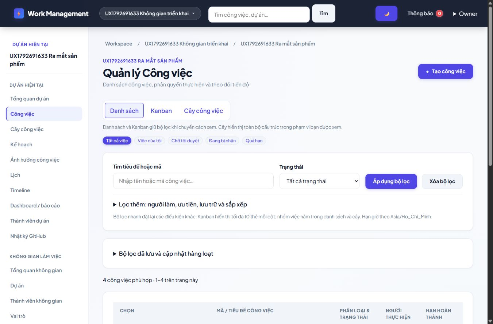
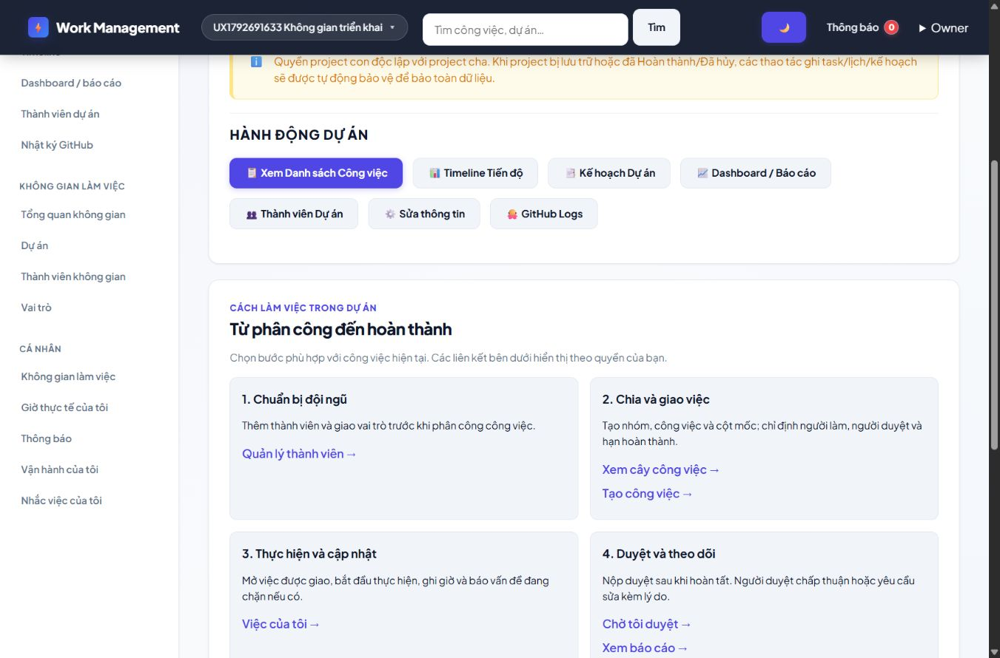
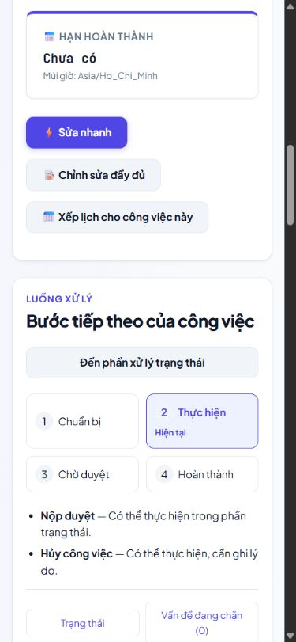

# Cập nhật trải nghiệm và luồng thao tác — 23/10/2026

Đã triển khai trên mã nguồn Laravel MVC/Blade sau bản nghiệm thu `d669f4d`. Mục tiêu là giúp người dùng nhận biết đang ở đâu, tìm đúng việc, cập nhật nhanh và hiểu vì sao một bước bị chặn. Đây là cải tiến trải nghiệm của hệ thống hiện có, không phải chứng nhận khả năng vận hành ở quy mô doanh nghiệp.

## Những thay đổi đã hoàn thành

| Vấn đề trước đây | Hành vi hiện tại |
| --- | --- |
| Menu dàn phẳng, trang sửa/chi tiết không đánh dấu đúng mục | Menu chia nhóm, ưu tiên dự án hiện tại; route con đánh dấu mục cha phù hợp; cây có mục riêng. Breadcrumb task có đường về danh sách. |
| Menu mobile khó tìm cách đóng | Có nút “Đóng điều hướng” ngay trong drawer; mở menu đặt focus vào nút, đóng trả focus về Menu; Escape và giới hạn vòng Tab vẫn hoạt động. |
| Danh sách và Kanban không cùng bộ lọc | Dùng chung partial Blade, GET form, preset, trạng thái, người làm, ưu tiên, lưu trữ/sắp xếp. Đổi Danh sách ↔ Kanban giữ điều kiện. Cây luôn là toàn bộ cấu trúc có quyền xem và ghi rõ điều này. |
| Quá nhiều điều khiển xuất hiện ngay từ đầu | Tìm kiếm/trạng thái ở hàng chính; điều kiện phụ trong “Lọc thêm”; lưu bộ lọc/hàng loạt trong disclosure. Chọn một dòng tự mở công cụ hàng loạt. |
| Không rõ số kết quả hay phạm vi thời gian | Hiển thị tổng kết quả, khoảng dòng; Kanban đếm WORK/MILESTONE, tối đa 10 thẻ mỗi cột. Hạn giờ thống nhất theo timezone workspace. |
| Trang task dài, khó tìm bước cần xử lý | Có “Bước tiếp theo”, trạng thái hiện tại, hành động theo quyền và lý do chặn thực tế; liên kết tới trạng thái, blocker, dependency, trao đổi/tệp, lịch sử, timer. |
| Người mới không biết bắt đầu từ đâu | Trang dự án có hướng dẫn đội ngũ → chia/giao việc → thực hiện → duyệt/theo dõi. Link tạo việc/quản lý thành viên/duyệt/báo cáo theo quyền. |
| JavaScript tự tạo thêm nút xóa bộ lọc làm rời Kanban | `data-filter-reset` nhận diện nút server tạo; giữ đúng `view=board`. Chỉ một nút reset. |

Giữ nguyên form POST/PATCH, CSRF, Policy, transaction, revision và trang đối chiếu 409. Không thêm API, package, migration, provider/key hay lớp kiểm thử.

## Flow qua các hàm

### 1. Vào trang và điều hướng

`AppShell::build(Request)` xác định workspace/project từ route và tham số hợp lệ → kiểm `WorkspaceAccess`/`ProjectAccess` → dựng menu chỉ gồm mục được phép → so tên route hiện tại với route mục menu. Route trùng chính xác được ưu tiên hơn prefix; prefix dài nhất thắng cho trang con. `components/layout.blade.php` nhóm menu và đặt `aria-current="page"`.

JS chỉ mở/đóng drawer, quản lý focus. Quyền không dựa vào việc một link có xuất hiện hay không; request trực tiếp vẫn qua Policy.

### 2. Tìm và chuyển cách xem

`tasks/_filters.blade.php` gửi GET tới route `.tasks.index` → `TaskController::index()` → `TaskFilters::clean()` chỉ nhận trường hợp lệ → truy vấn workspace/project hiện tại → `SearchTerm::contains()` tìm ký tự literal → `TaskFilters::applyPreset()` → sort/paginate → `tasks/index` hoặc `tasks/board`.

`_view-nav` dựng link từ bộ lọc đã được server làm sạch, không dùng URL redirect do người dùng cung cấp. Chuyển view bắt đầu lại phân trang. Preset nhanh cố ý đặt lại các điều kiện khác, nhưng giữ view; nút reset cũng giữ view. Cây không áp dụng bộ lọc danh sách để không làm đứt cấu trúc cha/con.

### 3. Xem bước tiếp theo

`TaskController::show()` scope/bind và authorize task → nạp blockers/dependencies/history → `TaskWorkflowService::availability()` → các action `enabled`, `reason`, `needs_reason`. `tasks/_journey` và form trạng thái dùng cùng dữ liệu này. Không sao chép state machine sang JavaScript.

Stepper chỉ đánh dấu **trạng thái hiện tại**, không suy đoán các bước đã từng hoàn thành. GROUP hiển thị giải thích tổng hợp từ việc con; CANCELLED và archived có thông báo riêng. Không có quyền ghi thì thấy giải thích, không có form chuyển trạng thái.

### 4. Thực hiện hoặc sửa công việc

Link trong journey đến `#task-workflow` và chuyển focus vào section. Form thật → controller trạng thái → `TaskWorkflowService::status()` → `locked()`/transaction → kiểm `expected_status`, Policy, reason, blocker/FS/timer → update task → `TaskHistory::record()` → `TaskTreeService::sync()` → redirect/flash → server dựng lại journey.

Sửa nhanh tiếp tục `TaskRequest` → `TaskController::update()`/`saveEdit()` → `TaskService::save()`. `expected_revision` cũ dẫn tới `TaskEditConflict` và HTML 409; người dùng so sánh/chọn dữ liệu rồi gửi form giải quyết xung đột. Journey không tự ghi trạng thái và không bỏ qua bước duyệt.

## Kiểm tra đã thực hiện

- **30 điểm xác nhận qua 59 request HTTP** trong lần chạy đầy đủ cuối: login/session/CSRF thật, tạo workspace/project/3 WORK/1 GROUP, kiểm nav 8 trang, filter list/Kanban, empty state, viewer/403, blocker, toàn bộ trạng thái, lý do mở lại, quick edit và 409. Đây là số điểm xác nhận, không phải 30 bộ test độc lập.
- Kiểm tra bổ sung sau chỉnh menu cuối: 5 điểm xác nhận/9 request cho không gian cá nhân, dashboard nhóm, chi tiết và assets; xem `flow-final-smoke.json`.
- Browser 1366×900 và 390×844: tìm kiếm, giữ bộ lọc khi chuyển view, reset giữ Kanban, chọn dòng mở công cụ; menu mobile, sửa nhanh, preset 2 giờ, submit, link/focus đến trạng thái, bấm bắt đầu. SQL xác nhận tiêu đề đã sửa, `estimate_minutes=120`, `status=IN_PROGRESS`.
- Danh sách, chi tiết và Kanban không gây tràn ngang toàn trang ở kích thước đã đo. Kanban cuộn ngang bên trong vùng có nhãn. Console thu được 0 lỗi/cảnh báo.
- PHP lint, Pint, JS syntax, Blade cache và `git diff --check` đạt. Các file runtime ở bản kiểm tra khớp hash với mã nguồn bàn giao.
- So sánh nội dung **31 bảng** DB chính và hash `.env` trước/sau: không đổi. Database kiểm tra riêng không có lỗi foreign key.

Minh chứng: [summary](verification/ux-workflow-2026-10-23/summary.json), [flow HTTP](verification/ux-workflow-2026-10-23/flow-experience.json), [browser và SQL](verification/ux-workflow-2026-10-23/ux-browser.json), [kiểm tra kỹ thuật](verification/ux-workflow-2026-10-23/technical.json).

Trong lúc chuẩn bị kịch bản đã sửa lỗi của công cụ kiểm tra: console Windows không in được tiếng Việt; dữ liệu lịch sử cần giải mã JSON và chấp nhận reason null; ProjectMember liên kết User qua WorkspaceMember. Dấu vết các lần dở dang được giữ ở `attempt-*.json`. Lần cuối chạy đầy đủ đã hoàn tất; không coi các lần dở dang là kiểm tra đạt. Kiểm tra UI còn dẫn đến sửa nút reset trùng, typography nhóm menu bị theme toàn cục đè và thêm nút đóng drawer rõ ràng. Sau đổi drawer/format PHP đã kiểm lại trên browser và biên dịch, không chạy lại toàn bộ nghiệp vụ không đổi.

## Bảo trì và cập nhật

- [Hướng dẫn người dùng](USER_WORKFLOW_GUIDE.md) mô tả flow hàng ngày.
- [Bàn giao FE](FRONTEND_HANDOFF.md) có contract partial/selector và danh sách kiểm tra khi thiết kế lại.
- CSS của đợt này nằm riêng trong `public/css/workflow-experience.css`, tải sau theme cũ. Chỉ override `!important` cho các selector bị theme cũ ép; không đổi global h1/h2.
- Lượt này không đổi schema/dependency. Triển khai code mới theo quy trình trong `DEPLOYMENT.md`, giữ `.env`/APP_KEY/database/storage riêng của môi trường. Có thể chạy `php artisan view:clear`, `php artisan view:cache`; dùng Ctrl+F5 nếu trình duyệt còn asset cũ. Không cần tạo API hoặc build frontend cho các partial này.
- Không dùng `migrate:fresh`, không chép DB kiểm tra vào môi trường thật. Nếu thay schema sau này, tạo migration mới và kiểm thử trên bản sao trước khi triển khai.

## Những điểm còn nên xem xét

1. Thử nghiệm với người dùng thật để đo thời gian hoàn thành thao tác; hiện mới có kiểm tra kỹ thuật và thao tác đại diện, chưa có nghiên cứu usability.
2. Theme cũ có nhiều inline style/`!important`; nên gom dần về component và design tokens khi chỉnh từng màn hình, tránh thay đồng loạt gây hồi quy.
3. Kanban chưa kéo thả trạng thái. Nếu thêm phải dùng cùng service, hiển thị reason/reviewer/409 và giữ phương án form với bàn phím.
4. Chưa kiểm tải lớn, nhiều người sửa đồng thời trên hạ tầng production hoặc screen reader chuyên dụng. Các kiểm tra revision hiện có xác nhận từ chối ghi đè cũ, không thay cho load test.
5. Provider AI/SMTP/GitHub công khai, key và vận hành production vẫn theo giới hạn trong báo cáo nghiệm thu trước. Đợt UI không thay đổi các điều kiện này.

## Hình ảnh

