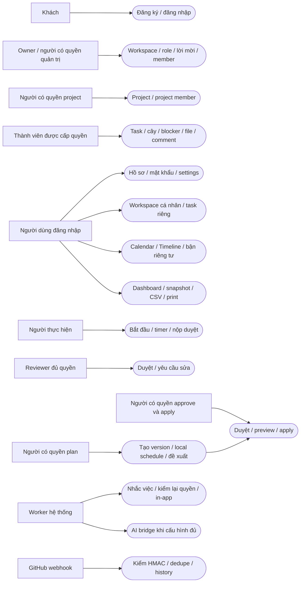
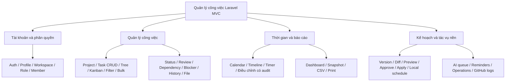
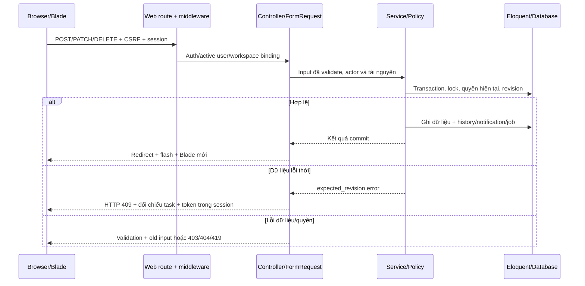

**Cập nhật cuối đợt:** schema nguồn/review là **27 bảng nghiệp vụ + 8 hạ tầng = 35 bảng**, bổ sung calendar_proposals, task_watchers, task_templates, task_template_runs. Migration chính đang chờ xác nhận, hiện vẫn31bảng. ERD/schema JSON đã sinh lại từ PRAGMA review. [Báo cáo F11–F14](../FULL_FUNCTIONAL_COMPLETION_2026-10-23.md) thay mô tả31bảng ở bản lịch sử bên dưới.

# Thiết kế hệ thống hiện hành — 23/10/2026

Tài liệu này mô tả bản đã triển khai. Kế hoạch V3 và sơ đồ 20 bảng cũ là mốc thiết kế; migration hiện hành có **23 bảng nghiệp vụ + 8 bảng hạ tầng Laravel = 31 bảng**. Ba bảng nghiệp vụ bổ sung là saved_task_filters, task_reminders, time_entry_adjustments. Không có migration mới trong đợt nghiệm thu này.

- [ERD hiện hành đầy đủ](ERD_CURRENT.mmd): sinh từ foreign key thực tế, bao gồm các bảng bổ sung.
- [Schema hiện hành](schema-current.json): cột, nullable, mặc định, khóa ngoại, on_delete và index; không chứa dữ liệu người dùng.
- [ERD V3 gốc](AI_Work_Management_ERD_V3.drawio): giữ nguyên để đối chiếu lịch sử.

## Người dùng, phạm vi và ràng buộc

Khách đăng ký/đăng nhập. Tài khoản có workspace cá nhân do chính mình sở hữu, hoặc là thành viên workspace nhóm. Role workspace và role project độc lập; việc nhìn thấy workspace không cấp quyền vào mọi project. Quyền còn phụ thuộc membership hoạt động, trạng thái project/task, người được giao và reviewer; UI chỉ hiển thị thao tác phù hợp, backend luôn kiểm lại.

Vai trò | Quyền tiêu biểu mặc định | Điều kiện bổ sung
---|---|---
Owner | Quản lý role/member, project/task, duyệt/apply plan, integration | Chuyển chủ chỉ workspace nhóm; không xóa dữ liệu nghiệp vụ đang tồn tại
Manager | Quản lý project/member/task, review, plan, report | Không mặc định quản trị role, vận hành workspace hoặc secret tích hợp
Member | Xem, tạo/sửa task, bình luận/file, tạo lịch, tạo plan | Không mặc định assign/review/approve/apply; project membership và Policy vẫn áp dụng
Viewer | Xem tài nguyên được cấp | Không được ghi; lịch private chỉ bận/rảnh và snapshot report cần quyền hiện tại

Nguồn quyền chi tiết: config/permissions.php, WorkspaceAccess, ProjectAccess và Policies. Custom role chọn từ catalog; không tự coi tên role là toàn bộ quyền.

## Sơ đồ ca sử dụng

[Sơ đồ UML use-case](USE_CASES.puml) dùng ký pháp actor/usecase/include trong PlantUML. Sơ đồ Mermaid bên dưới là bản xem nhanh tác nhân–chức năng; không thay thế ký pháp UML. File PlantUML được bàn giao dạng nguồn, chưa render bằng trình biên dịch PlantUML trong môi trường này.

## Sơ đồ chức năng

## Luồng MVC ghi dữ liệu

## Quy tắc cần trình bày khi bảo vệ

1. GROUP tổng hợp từ con, WORK lá mới có estimate; chống chu trình và vượt độ sâu. Task đã có history được lưu trữ thay vì xóa vật lý.
2. TODO → IN_PROGRESS → REVIEW → DONE; hủy/mở lại/yêu cầu sửa phải có lý do. Không vượt blocker/FS/lag hoặc timer đang chạy.
3. Thời gian lịch/deadline lưu UTC; form/preset dùng timezone của workspace. Estimate, planned và actual là ba số liệu khác nhau.
4. Plan version là đề xuất; preview rollback, chỉ apply sau duyệt, recheck nguồn/quyền và transaction. Local scheduler chỉ xếp WORK của người yêu cầu; không gọi đó là AI.
5. Attachment lưu private, tải qua Policy. HMAC thay CSRF chỉ cho webhook GitHub; tất cả form thông thường vẫn CSRF.
6. Report snapshot bất biến; người tạo và quyền nguồn hiện tại được kiểm khi đọc. Worker cũng kiểm lại quyền trước khi xử lý.
7. AI chưa cấu hình phải báo failed thật. Không ghi thành công giả, không tự trả phí, không ghi đè task từ câu trả lời chưa duyệt.

## Giới hạn thiết kế

SQLite đã kiểm local; chưa đánh giá nhiều instance hoặc tải lớn. Tree/plan/search còn tải tập dữ liệu phạm vi để tính quyền/cấu trúc, cần profiling trước khi vận hành hàng chục nghìn task. Không có Google Calendar/Telegram hay email digest; SMTP, Redis production, AI bridge và webhook công khai là các mục cấu hình/kiểm chứng sau.

## Bổ sung kiến trúc tài khoản/vận hành

Không đổi31 bảng. Password broker dùng password_reset_tokens có sẵn; email_verified_at của users dùng xác minh email. User implements MustVerifyEmail, dùng AccountMailService thay vì đổi quan hệ notifications hiện hành. Recovery xóa session cũ; middleware RequireVerifiedAccount mặc định chặn nghiệp vụ ở production khi chưa xác minh. Lịch Laravel đã có recover-stale, clear-resets và heartbeat; preflight kiểm DB/cache/session/host/config. SQLite backup bao gồm private task-files và đối chiếu hash. Chi tiết flow ở báo cáo readiness23/10/2026.
